

    

    <h2>Gameyfin</h2>
    <h4>Manage your video games.</h4>
    
simple / fast / <a href="https://gameyfin.org/blog/2025/12/22/why-gameyfin-is-foss/">FOSS</a>

## Overview

Name and functionality inspired by [Jellyfin](https://jellyfin.org/).

Gameyfin will turn your disorganized collection of video games into a beautiful, easy-to-navigate library that you can
access from any device with a web browser.  
It will automatically scan your game folders, download metadata and cover images, and present everything in a
user-friendly interface.  
Download your game files directly from the web UI, share your library with friends, and enjoy your games like never
before.

### Server announcements

This branch adds a configurable server message to the home page. In **Administration → System**, edit
**Server Message (HTML)** and use **Show Server Message** to control whether it appears above the library and collection
sections. Leave the message empty or turn off the checkbox to hide it.

Messages support HTML, including inline styling.

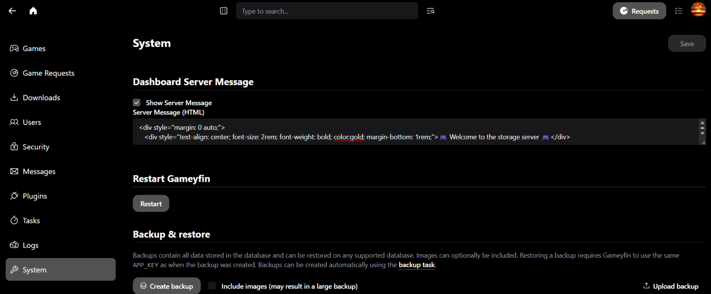

The message is then shown to all users on the home page.

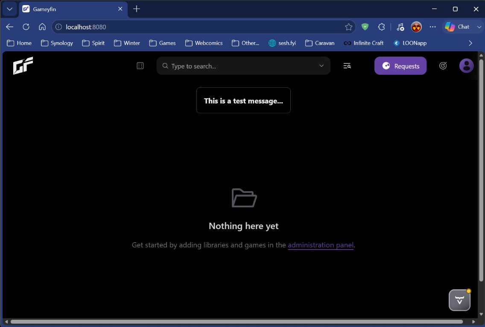

### Improved metadata search

This branch improves the manual metadata match dialog. First, you can combine two search results. Sometimes the same game shows
up on two lines, for example when GOG and Steam list different release years. Click **Combine with another result** on
one line, then pick the second line. The provider IDs of both are used together and merged with the usual plugin
priorities, as if Gameyfin had merged them itself.

* Combining is always a manual action. Gameyfin never suggests or links results on its own, so similarly named games
  (such as Mass Effect and Mass Effect Legendary Edition) are not mixed up.
* Each provider supplies one ID per game, so results that share a provider with the first one are disabled.
* No backend, API or database changes for combining. Only the match dialog changes.

#### Screenshots

Here the same game is listed on two lines, because one source has no release year. Each line has a **Combine** button
(link icon), an **Add base game** button (plus icon) and the usual **Pick** button (arrow).

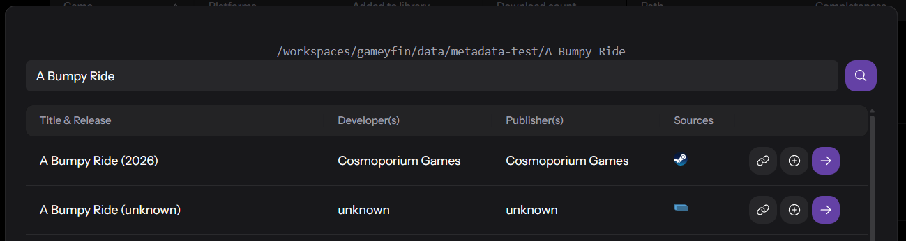

After you press **Combine** on one line, that line and every line from the same source are disabled. Pick the second
line to use both together.

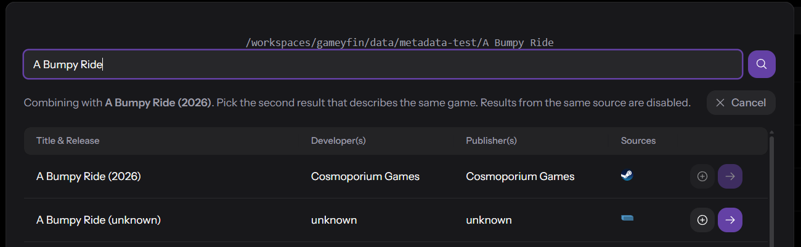

#### Adding a base game to an edition

Special editions often have very little metadata of their own (sometimes just one image and a description). Click
**Select this, then add a base game for missing metadata** on the edition (or on a combined edition), then pick the base
game, using **Combine with another result** again if it is split over several lines.

* The edition's metadata always wins. The base game only fills fields the edition leaves empty, such as the description
  or screenshots. Nothing is overwritten, whatever the plugin priorities are.
* If the base game has no metadata either, nothing is added. Gameyfin never invents metadata.
* The base game is stored in its own table (`GAME_SUPPLEMENT`) and re-applied when metadata is refreshed. Existing tables
  are not changed. Matching a game again without a base game removes it.

##### Screenshots

Search for the edition, then press the plus icon on the edition's line.

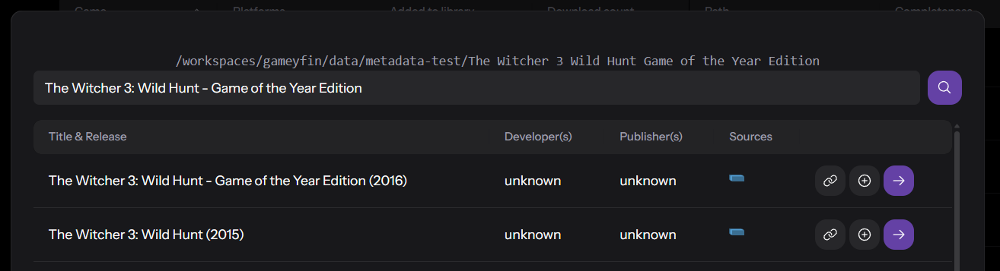

The edition stays selected and you pick the base game from the list.

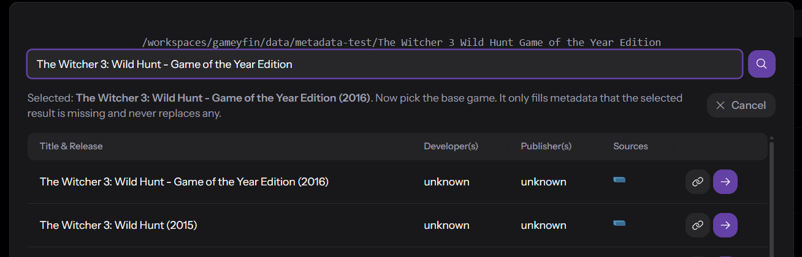

### Inspect metadata sources

This branch adds an **Inspect metadata sources** button (magnifier-list icon) to every result in the manual metadata
match dialog. It shows what each metadata provider returns for that result, side by side, so you can see which source
gives the better information and whether your plugin priorities make sense. Nothing is shown anywhere else, so the rest
of the UI stays uncluttered.

* The inspection covers exactly what picking the result would merge: a pending **Combine** and an **Add base game**
  selection are included (the base game's sources are marked "(base game)").
* One column per source, one row per field. The value that ends up in the game, following the plugin priorities, is
  highlighted in green.
* Values from other sources that differ from the used value are marked with a warning icon and highlighted in yellow.
* Each column header shows how many fields the source provided and how many of those it actually won. A source that
  returned nothing or failed is shown as "No data" or "Error" (hover for the reason) instead of being left out.
* Genres, platforms and so on use their display names, and a meaningless "Unknown" is hidden next to real values.
* Cover, header and screenshots are shown as small thumbnails. Hover one for a bigger preview.
* Click a summary to expand it. Keywords and videos show a count, hover to see them in full.
* **Only show differences** hides the rows where the sources agree.
* Inspecting is read-only: nothing is saved and no game is created or changed.
* The data comes from a new admin-only endpoint, `GameEndpoint.inspectMetadataSources`. There are no database changes.

#### Used in your library

To see which plugin is giving you the most, open a metadata plugin in the plugin administration. It shows how many
metadata fields of your games currently come from that plugin, per field. This is read from the field sources Gameyfin
already stores for every game, so it needs no extra data (admin-only endpoint `GameEndpoint.getMetadataSourceStats`).
Fields you edited yourself are not counted for any plugin.

#### Screenshots

Open the inspector with the magnifier-list icon on a search result. The value used in the game is highlighted in green.
Here SteamGridDB wins the title, release, cover and header, while Steam supplies the rest.

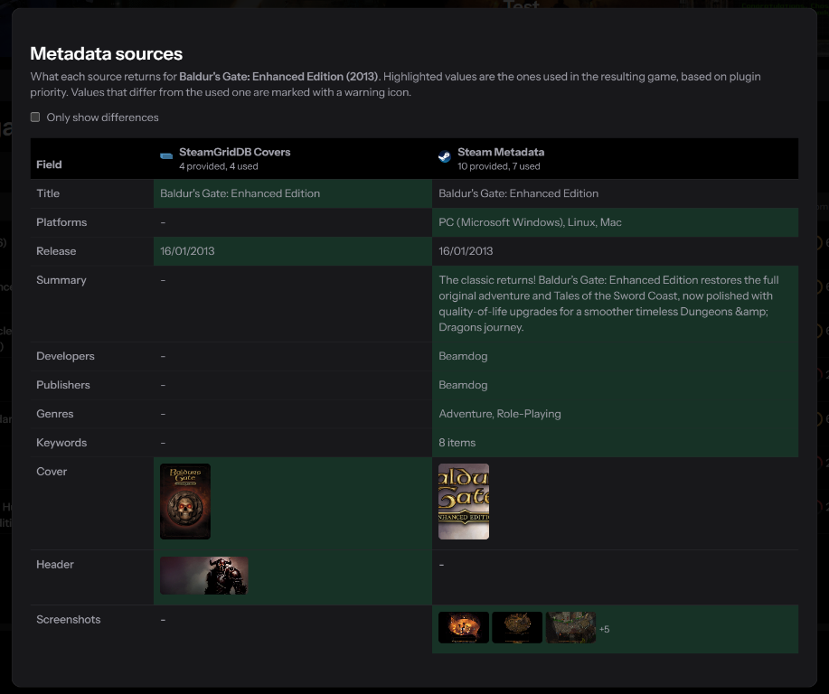

Hover a thumbnail for a bigger preview.

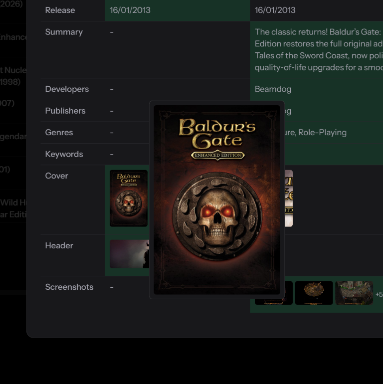

**Only show differences** hides the rows where the sources agree. Images always count as different, as their URLs
differ by nature.

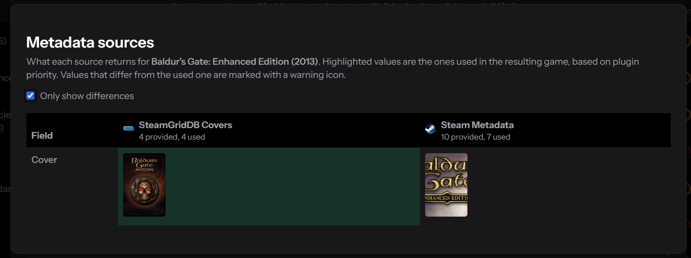

An edition with a base game. The base game's source (here 0 used) only fills fields the edition leaves empty. Values
that differ from the used one, such as the base game's title and release year, are marked with a warning icon.

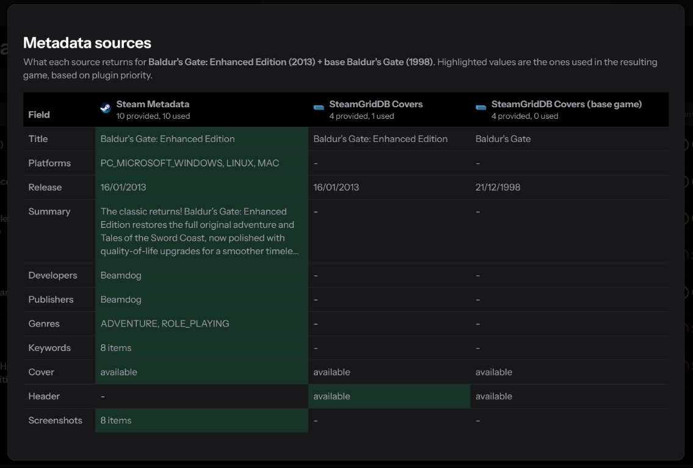

The plugin details show how many fields of your library each metadata plugin currently supplies.

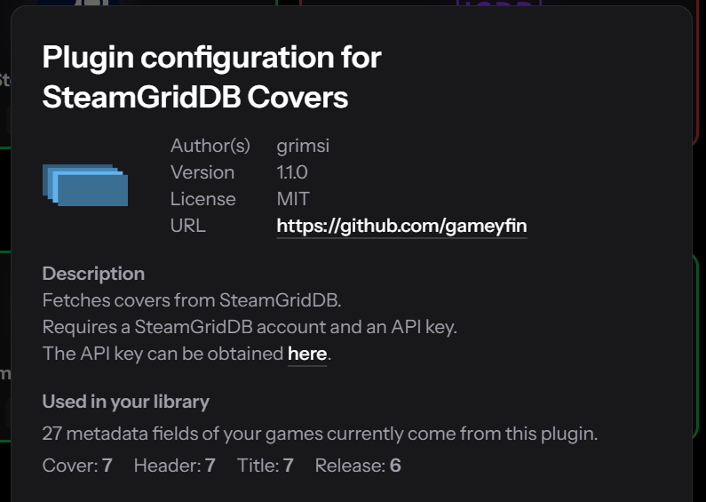

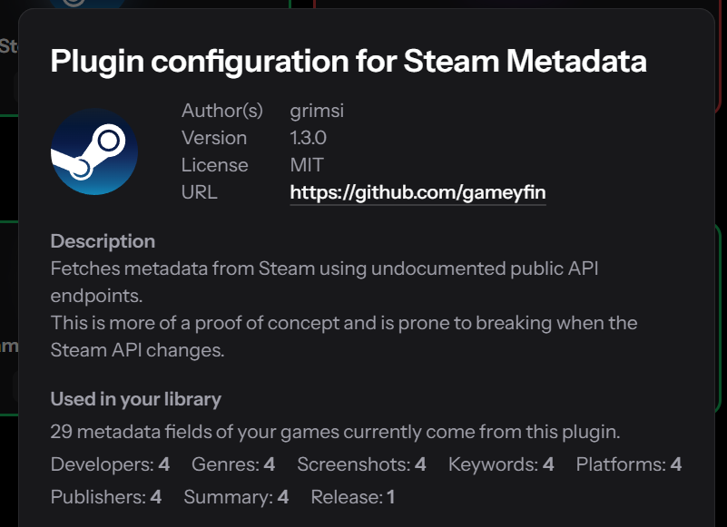

### Pin metadata fields to a source

This branch builds on the inspector and makes it interactive. When plugin priority picks the worse value for a field,
you can **pin** that field to the source you prefer instead.

* In the inspector, click the pin next to a value to use that source for the field. Click the pin on a pinned value, or
  pin the source that wins anyway, to remove the pin. **Reset pinned fields** removes all of them.
* **In the match dialog:** pins are applied when you pick that result (the row shows a green pin). They belong to that
  exact selection, so picking a different result or changing the combined/base game selection starts without pins.
* **On an existing game:** the pin icon next to the edit and search buttons in the game view opens the inspector for the
  game's stored sources. **Apply** saves the pins and refreshes the game right away.
* A pin follows the *source*, not a frozen value: a metadata refresh keeps using the pinned source and picks up its
  updated data. If the pinned source stops providing the field, plugin priority decides again.
* Fields you edited by hand are never overwritten by a pin. A new manual match replaces the pins of the game with the
  ones you set in that match.
* Admin-only endpoints: `GameEndpoint.getMetadataLinks`, `GameEndpoint.setFieldOverrides`, and an optional
  `fieldOverrides` argument on `matchManually`. Pins are stored in a new `game_field_override` table (Liquibase
  changeset `2.6.0-game-field-override`).

#### Screenshots

The inspector opened from the game view of an existing game. Pins appear next to values that are not currently used.
**Apply** saves them.

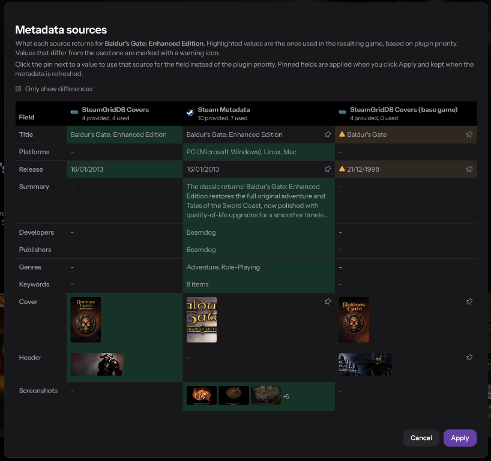

Four fields pinned to the base game's source. Pinned values show a filled pin and are highlighted as used, while the
values that lost are marked with a warning icon. **Reset pinned fields** removes all pins.

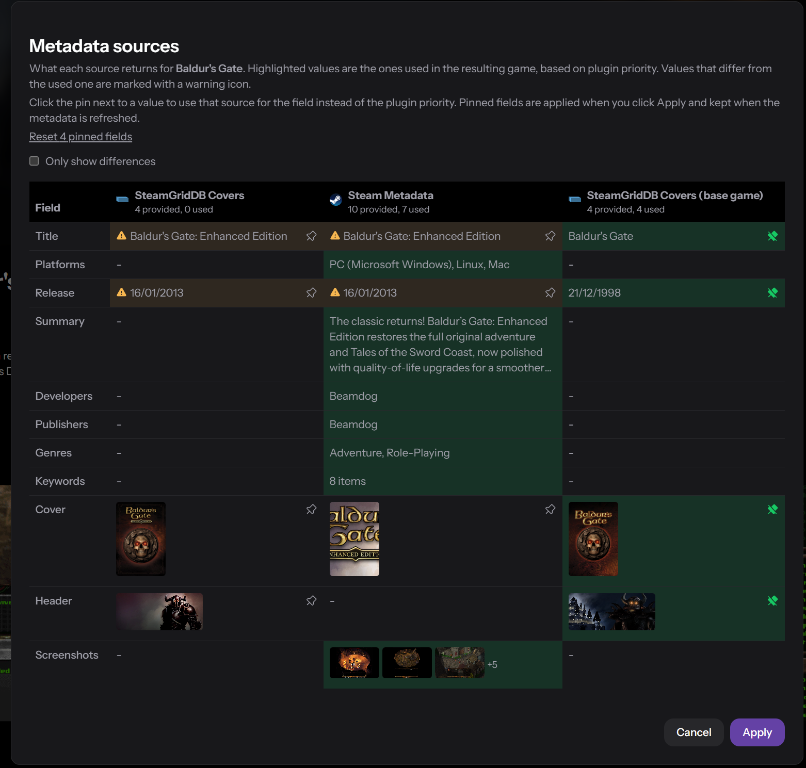

### Documentation

The documentation and screenshots are available at [gameyfin.org](https://gameyfin.org/).

### Features

✨ Automatically scans and indexes your game libraries  
⬇️ Access your library via your web browser & download games directly from there  
👥 Share your library with friends & family  
⚛️ LAN-friendly (everything is cached locally - except for videos)  
🐋 Runs in a container or any system with a JVM  
🌈 Themes (including colorblind support)  
🔌 Easily expandable with plugins  
🔒 Integrates into your SSO solution via OAuth2 / OpenID Connect  
🆓 **100% open source and free to use without any paywall.**

### Feature branches

These features are also available as standalone branches, each with its own README and screenshots:

* [Server announcements](https://github.com/Shade1982/gameyfin/blob/feature/announcements/README.md) (`feature/announcements`)
* [Improved metadata search](https://github.com/Shade1982/gameyfin/blob/feature/improved-metadata-search/README.md) (`feature/improved-metadata-search`)
* [Inspect metadata sources](https://github.com/Shade1982/gameyfin/blob/feature/inspect-metadata-sources/README.md) (`feature/inspect-metadata-sources`)
* [Pin metadata fields to a source](https://github.com/Shade1982/gameyfin/blob/feature/metadata-field-overrides/README.md) (`feature/metadata-field-overrides`)

### Contribute to Gameyfin

Contributions are welcome!  
There are no strict requirements to contribute, but please contact us first if you want to implement a new feature or
change the design of the application before you start working on it.

### Gameyfin Trademark and Attribution Notice

Gameyfin is free and open-source software licensed under the GNU Affero General Public License version 3.  
The name "Gameyfin" and the official Gameyfin logos identify the original Gameyfin project.  
Permission to use, modify, and distribute the source code does not imply official affiliation with, endorsement by, or support from the Gameyfin project.  
Modified versions and third-party applications must not misrepresent their origin or imply official endorsement by the Gameyfin project.  
Third-party projects may describe their compatibility with Gameyfin, provided that such descriptions do not mislead users regarding the project's origin or official status.  
The Gameyfin project reserves any trademark rights it holds in its name and logos.

### Acknowledgements

  
Gameyfin is supported by [YourKit](https://www.yourkit.com/), the makers
of [YourKit Java Profiler](https://yourkit.com/java/profiler/), a powerful tool for profiling Java and Kotlin
applications.
