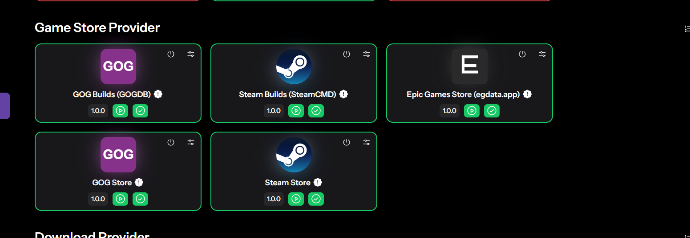
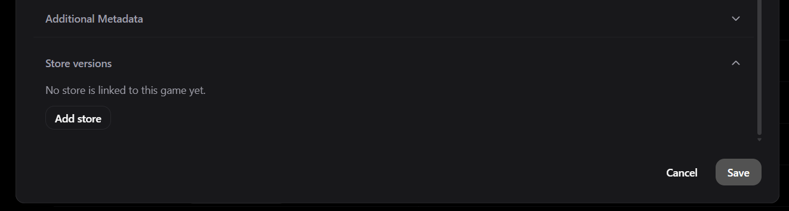
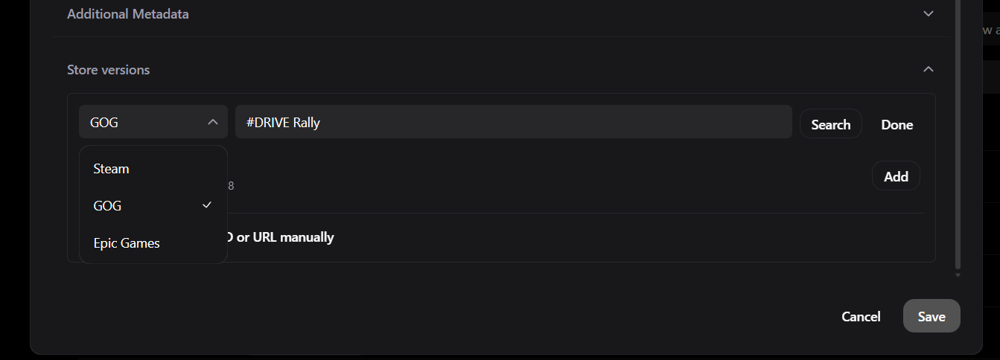
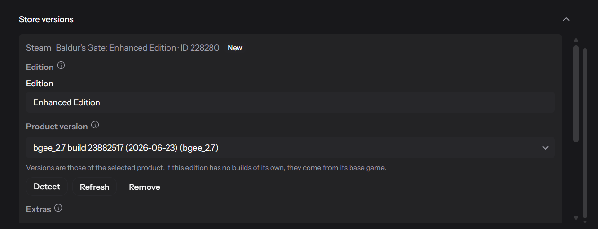
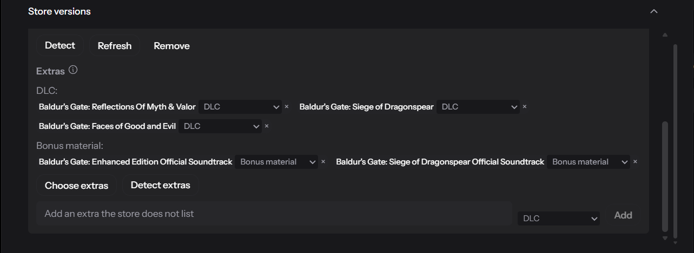
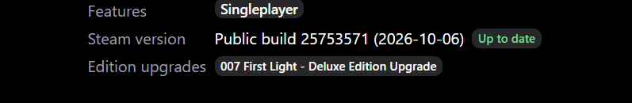
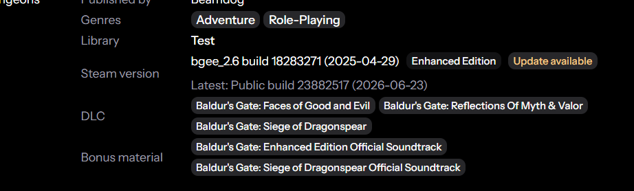
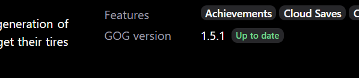

    

    <h2>Gameyfin</h2>
    <h4>Manage your video games.</h4>
    
simple / fast / <a href="https://gameyfin.org/blog/2025/12/22/why-gameyfin-is-foss/">FOSS</a>

## Overview

Name and functionality inspired by [Jellyfin](https://jellyfin.org/).

Gameyfin will turn your disorganized collection of video games into a beautiful, easy-to-navigate library that you can
access from any device with a web browser.  
It will automatically scan your game folders, download metadata and cover images, and present everything in a
user-friendly interface.  
Download your game files directly from the web UI, share your library with friends, and enjoy your games like never
before.

### Editions, versions, and included DLC

Gameyfin can track the store version of your games, the edition you own, and the DLC included with your copy. Link
store products to a game in its metadata editor, label editions such as Deluxe, and compare the latest store version
with the version in your library. Gameyfin can suggest DLC from names in your game library, and you can adjust the
selection or add extras the store does not list. Game details show the edition, version, and included extras.

#### Game Store Provider plugins

Stores are provided by plugins in the new **Game Store Provider** category, listed between the metadata and download
provider categories. There is one plugin per data source:

| Plugin | Store | Provides |
|---|---|---|
| `plugins/steamstore` (Steam Store) | Steam | Search, DLC |
| `plugins/steamcmd` (Steam Builds, unofficial) | Steam | Versions (branch builds) |
| `plugins/gog` (GOG Store) | GOG | Search, versions, DLC |
| `plugins/gogdb` (GOG Builds, unofficial) | GOG | Versions, edition names |
| `plugins/epic` (Epic Games Store, egdata.app) | Epic | Search, versions, DLC |
| `plugins/itch` (itch.io, public pages) | itch.io | Search, versions (undated upload names, no DLC or editions) |

- **Several sources per store:** search and versions use the highest-priority source that has a result and fall back
  to the others. DLC and edition names from all sources are merged without duplicates.
- **Order:** the store dropdown follows the plugin order set in the plugin admin menu, so you can put your most used
  store first.
- **Search is optional:** plugins that cannot search (SteamCMD, GOGDB) only add data. If no enabled plugin of a store
  can search, you can still add products by ID or URL.
- **No store plugin enabled:** the **Store versions** section is hidden and the refresh task does nothing.
- **Plugin disabled:** its links stay visible read-only with cached data and are not refreshed.

#### Writing a store plugin

Store plugins are separate from metadata plugins: a plugin that provides metadata does not provide store data. A
plugin that wants to add a store ships as its own plugin implementing the `GameStoreProvider` extension point of the
plugin API. It becomes another source for its store and is combined with the others as described above. Only implement what
your source provides: `search`, `fetchVersions`, `fetchDlc` and `suggestEditions` all have empty defaults, and a
plugin that cannot search should set `supportsSearch = false`.

The Steam builds, GOGDB, Epic and itch.io plugins use unofficial services or scrape public pages. `.github/workflows/store-plugins-live-check.yml`
runs a small live test for them every week. To run it locally, set `GAMEYFIN_LIVE_TESTS=true` and run the tests of
`:plugins:steamcmd`, `:plugins:gogdb`, `:plugins:epic` and `:plugins:itch`.

#### Screenshots

Open **Store versions** in the game metadata editor and choose **Add store**, then pick one of the enabled stores and
search for the game.

A linked store has an edition and the product version to track.

Each link also has an **Extras** section for DLC, edition upgrades, and bonus material that come with your copy. Use
**Detect extras** to suggest them from your files, or add extras the store does not list.

Game details show the store version with an update status, plus the selected extras.

### Documentation

The documentation and screenshots are available at [gameyfin.org](https://gameyfin.org/).

### Features

✨ Automatically scans and indexes your game libraries  
⬇️ Access your library via your web browser & download games directly from there  
👥 Share your library with friends & family  
⚛️ LAN-friendly (everything is cached locally - except for videos)  
🐋 Runs in a container or any system with a JVM  
🌈 Themes (including colorblind support)  
🔌 Easily expandable with plugins  
🔒 Integrates into your SSO solution via OAuth2 / OpenID Connect  
🆓 **100% open source and free to use without any paywall.**

### Contribute to Gameyfin

Contributions are welcome!  
There are no strict requirements to contribute, but please contact us first if you want to implement a new feature or
change the design of the application before you start working on it.

### Technical Details

Gameyfin v2 is written in Kotlin and uses the following libraries/frameworks:

* Spring Boot 3 for the backend
* Vaadin Hilla & React for the frontend
* PF4J for the plugin system
* H2 database for persistence

### Acknowledgements

  
Gameyfin is supported by [YourKit](https://www.yourkit.com/), the makers
of [YourKit Java Profiler](https://yourkit.com/java/profiler/), a powerful tool for profiling Java and Kotlin
applications.
